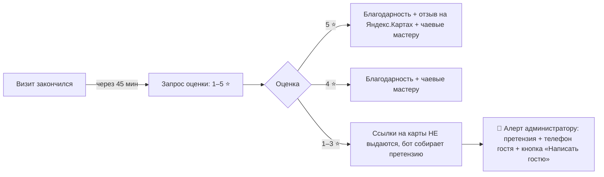
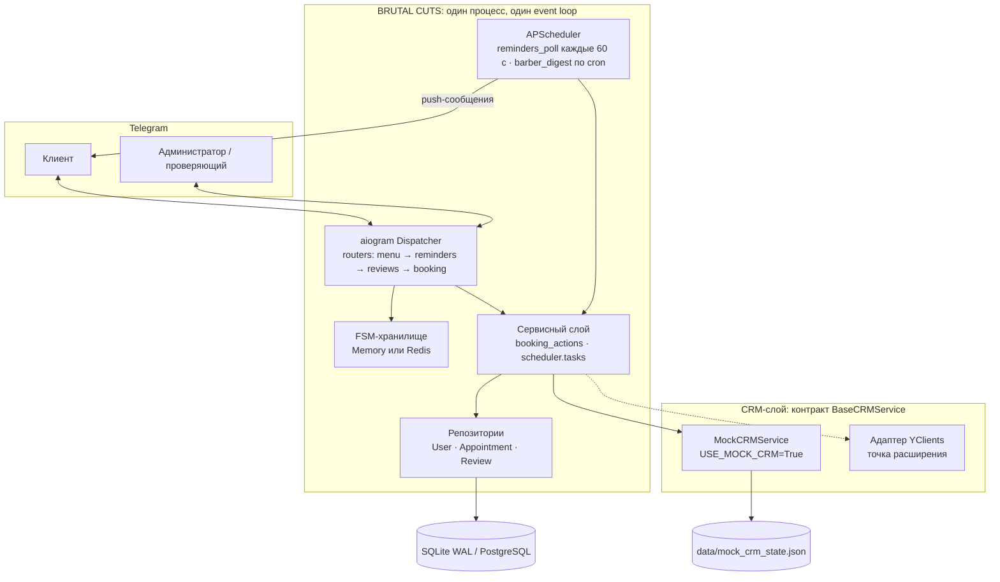
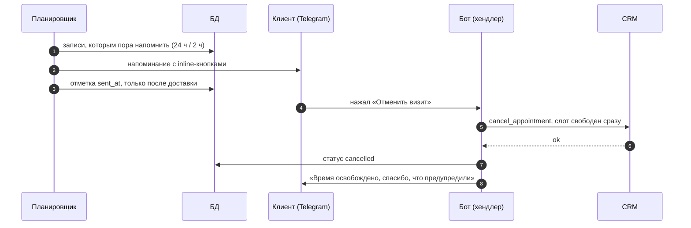

<div align="center">

# 💈 BRUTAL CUTS

### Telegram-бот для сети барбершопов: запись 24/7, анти-No-Show, защита рейтинга и рост LTV


_%2F_PostgreSQL-003B57?logo=sqlite&logoColor=white)


-DC382D?logo=redis&logoColor=white)


**[Бизнес-контекст](#-бизнес-контекст) · [Фичи](#-ключевые-фичи) · [Быстрый старт](#-быстрый-старт-за-3-команды) · [Debug-команды](#-debug-команды-для-проверяющего) · [Архитектура](#-архитектура) · [Конфигурация](#-конфигурация)**

</div>

---

## 🎯 О проекте

**BRUTAL CUTS** — клубный барбершоп в двух филиалах (м. Белорусская и м. Бауманская, 12 мастеров, три грейда). Бот заменяет администратора там, где тот хуже всего справляется: принимает записи в любое время суток, напоминает о визите так, чтобы гость пришёл, а после стрижки аккуратно собирает отзывы — не подставляя рейтинг на Яндекс.Картах.

Проект **работает «из коробки» без платных ключей**: внутри — автономный Mock-CRM с расписанием, прайсом, сменами мастеров и программой лояльности. Нужны только токен бота и ваш Telegram ID.

> 📌 Это демонстрационный проект. Бизнес-показатели ниже — целевые ориентиры, под которые спроектированы фичи, а не результаты эксплуатации на живых данных.

---

## 💼 Бизнес-контекст

Какие реальные боли барбершопа закрывает бот:

| Боль | Как решает бот | Целевой эффект |
|---|---|---|
| 🌙 **Ночной слив клиентов.** Гость решает записаться в 23:00 — администратор спит, трубку никто не берёт, он идёт к конкуренту. | Запись 24/7 без звонка: филиал → услуга → допы → мастер → дата → время → напиток → режим. Слоты живые, дубль исключён. | Ночной спрос превращается в записи, а не уходит конкурентам |
| 🚫 **No-Show ≈ 18%.** Пустое кресло — прямой убыток: мастер на окладе, слот не продать. | Напоминание за 24 ч с подтверждением и напоминание за 2 ч с навигацией. **1-Click отмена** мгновенно освобождает слот — его можно продать другому. | No-Show с **~18% до <5%** |
| 🔁 **Низкий LTV.** Гость пришёл один раз и «потерялся». | Бар, Silent Cut, личный мастер, баланс бонусов и уровни лояльности, чаевые мастеру в один тап, «Перенести» вместо «Отменить». | Рост повторных визитов и среднего чека |
| ⭐ **Хрупкий рейтинг на Яндекс.Картах.** Одна злая оценка весит как десять добрых. | **Review Gatekeeping:** на карты уходят только довольные (5★). Недовольный (1–3★) получает не ссылку, а живого управляющего — алерт с текстом претензии и телефоном гостя. | Негатив решается до публикации, рейтинг растёт |

---

## ✨ Ключевые фичи

### ✂️ Онлайн-запись
Пошаговый FSM-сценарий на inline-кнопках: календарь на 14 дней, часовые окна 10:00–21:00, многочасовые услуги (комплекс — 2 часа) требуют двух свободных окон подряд. Слот перепроверяется перед записью **дважды** — в CRM и в локальной БД; если сохранение в БД не удалось, запись в CRM автоматически откатывается. Телефон запрашивается один раз кнопкой «Поделиться контактом» (чужой контакт отклоняется).

### 💈 Выбор мастера и динамический прайсинг
Три грейда — **Junior / Pro / Chef**, цена зависит от грейда:

| Услуга | Junior | Pro | Chef |
|---|---:|---:|---:|
| Мужская стрижка (60 мин) | 1 800 ₽ | 2 200 ₽ | 2 800 ₽ |
| Моделирование бороды (45 мин) | 1 200 ₽ | 1 400 ₽ | 1 600 ₽ |
| Комплекс: стрижка + борода (120 мин) | 2 800 ₽ | 3 300 ₽ | 3 800 ₽ |

Допы (Патчи 300 ₽, Воск 400 ₽, Маска-детокс 700 ₽) стоят одинаково у всех. Режим **«Любой свободный мастер»** назначает самого доступного по цене. Если на выбранное время свободен только старший грейд, **ценник пересчитывается** и бот просит явное согласие гостя («✅ Подтверждаю (цена)» / «🔄 Выбрать другое время») — никаких сюрпризов на кассе.

### 🍹 Барное меню
К визиту можно заказать напиток: Американо, Капучино, Лимонад или шот виски (бурбон — только 18+). Выбор попадает в карточку записи и в утренний дайджест мастера — бариста знает, что готовить, ещё до прихода гостя.

### 🔇 Silent Cut
Переключатель «тишина / общение» на финальном экране. Тихим гостям мастер не навязывает small talk: в дайджесте стоит метка `🔇 SILENT CUT`.

### ⏰ Напоминания 24 ч / 2 ч и 1-Click отмена
- **За 24 часа:** карточка визита и кнопки **[✅ Буду точно] [🔄 Перенести] [❌ Отменить визит]**. Не уходит, если до визита меньше 3 часов — тому, кто записался «на ближайший час», сутки не нужны.
- **За 2 часа:** точный адрес, как найти вход, путь от метро, парковка с моноширинной схемой, **код шлагбаума** и кнопка «Открыть в Яндекс.Навигаторе».
- **1-Click отмена:** одно нажатие — запись отменяется в CRM (слот свободен сразу), затем в БД. Повторное нажатие безопасно (идемпотентно).

### ⭐ Review Gatekeeping (воронка отзывов)
Через 45 минут после окончания визита гостю приходит «Как прошла стрижка у мастера Марка? Оцени работу от 1 до 5 звёзд»:



Оценка сохраняется сразу — даже если гость не напишет претензию, она не потеряется.

### ☕ Чаевые «нетмонет»
У каждого мастера своя ссылка на чаевые — кнопка «Оставить Марку на чай» появляется после оценки 4–5★, когда благодарность искренняя.

### 🎁 Баланс лояльности
По номеру телефона: баллы, число визитов и уровень — **Новичок** (0%), **Свой** (от 5 визитов, 5%), **Легенда** (от 15 визитов, 10%).

### 🌅 Утренний дайджест барберов
Каждый день в `DIGEST_TIME` мастера получают расписание: время, клиент, услуга с допами, напиток и метка Silent Cut. Мастера из `BARBER_CHAT_IDS` — в личку, остальные — сводкой по филиалу в общий чат.

---

## 🚀 Быстрый старт за 3 команды

**Нужно заранее** (две минуты, бесплатно): Python 3.11+, токен бота от [@BotFather](https://t.me/BotFather) и ваш Telegram ID от [@userinfobot](https://t.me/userinfobot). Затем **откройте своего бота и нажмите `/start`** — Telegram не даёт боту писать первым.

```bash
pip install -r requirements.txt                        # 1. зависимости (лучше в venv)
cp .env.example .env                                   # 2. впишите BOT_TOKEN и ADMIN_ID
python -m scripts.seed_demo_data && python -m src.main # 3. демо-данные и запуск
```

Всё. `USE_MOCK_CRM=True` стоит по умолчанию: **ключи YClients не нужны**, расписание, мастера и записи живут во встроенном Mock-CRM. Windows PowerShell: `copy .env.example .env`. Команды выполняются из корня проекта.

Что произойдёт после запуска (скрипт создал три демо-записи для вашего `ADMIN_ID`):

| № | Запись | Что вы увидите |
|:-:|---|---|
| 1 | Через **1,5 часа**, Белорусская | Сразу (первый проход планировщика): **напоминание за 2 часа** — адрес, парковка, код шлагбаума |
| 2 | **Завтра в 16:00**, Бауманская, Chef, комплекс | **Напоминание за 24 часа** с кнопками подтверждения и отмены — автоматически, когда до визита останется меньше суток |
| 3 | Визит закончился **50 минут назад** | Сразу: **запрос оценки** — запускает воронку Review Gatekeeping |

Не хотите ждать — используйте [debug-команды](#-debug-команды-для-проверяющего).

<details>
<summary><b>🐳 Запуск в Docker (PostgreSQL + Redis)</b></summary>

```bash
cp .env.example .env                                       # впишите BOT_TOKEN и ADMIN_ID
docker compose run --rm bot python -m scripts.seed_demo_data
docker compose up --build
```

`docker compose` поднимает бота, PostgreSQL 16 и Redis 7; `DATABASE_URL`, `USE_REDIS` и `REDIS_URL` подставляются автоматически. Состояние Mock-CRM лежит в томе `bot_data` и переживает пересоздание контейнера.

</details>

<details>
<summary><b>🔁 Скрипт демо-данных: параметры</b></summary>

```bash
python -m scripts.seed_demo_data                  # создать набор для ADMIN_ID
python -m scripts.seed_demo_data --reset          # пересоздать с актуальным временем
python -m scripts.seed_demo_data --user-id 42 --name "Алексей"   # другой клиент
```

- записи создаются теми же `UserRepository` / `AppointmentRepository`, что и боевой сценарий;
- каждая запись регистрируется в Mock-CRM, поэтому слот занят, а кнопки «Подтвердить» и «Отменить» работают по-настоящему; в конце запускается `sync_mock_crm_with_database` — как проверка согласованности БД и CRM;
- запись №3 хранится как «подтверждена», а не «завершена»: планировщик запрашивает оценку только по активным записям и сам переводит визит в «завершён» после отправки;
- если у клиента уже есть записи, скрипт ничего не трогает и подсказывает `--reset` (время демо-записей считается от момента запуска, поэтому для повторной демонстрации нужен `--reset`);
- запускайте скрипт **до** старта бота: Mock-CRM хранит состояние в памяти процесса. Если бот уже работает — перезапустите его после скрипта, при старте он сам подтянет записи из БД.

</details>

---

## 🧪 Debug-команды для проверяющего

Доступны **только** `ADMIN_ID` (остальным — «⛔ Команда доступна только администратору») и показываются в меню команд Telegram только администратору. Все сообщения помечены `🧪`.

| Команда | Что делает | На какую запись |
|---|---|---|
| `/test_reminder_24h` | Мгновенно присылает напоминание **за 24 часа** с кнопками **✅ Буду точно · 🔄 Перенести · ❌ Отменить визит** | Последняя созданная **будущая** запись — после seed это №2 |
| `/test_reminder_2h` | Мгновенно присылает напоминание **за 2 часа**: адрес, вход, парковка со схемой, **код шлагбаума**, кнопка Яндекс.Навигатора | Последняя **будущая** запись — после seed это №2 (Бауманская); автоматическое напоминание по №1 покажет Белорусскую |
| `/test_review` | Присылает **запрос оценки** `1⭐ … 5⭐`. Отзыв в БД **не сохраняется** — воронку можно проходить сколько угодно | Последняя запись любого статуса — после seed это №3 |
| `/test_digest` | Мгновенно запускает **утренний дайджест** барберов и отвечает сводкой: записей, сообщений, ошибок | Все активные записи на сегодня |

**Сценарий проверки воронки отзывов:** `/test_review` → нажмите `5⭐` (благодарность + кнопки «Отзыв на Яндекс.Картах» и «Оставить на чай») → снова `/test_review` → `2⭐` (ссылок на карты нет, бот просит описать проблему, а вам приходит `🚨 ЧП! Негативный отзыв!` с телефоном гостя).

> ⚠️ Кнопки в тестовых напоминаниях работают с **реальной** записью: «❌ Отменить визит» действительно отменит её и освободит слот в Mock-CRM. Верните демо-набор командой `python -m scripts.seed_demo_data --reset`.

---

## 🏗 Архитектура

Один процесс, один event loop: бот и планировщик работают рядом и общаются через БД и CRM-слой.



Жизненный цикл напоминания и 1-Click отмены:



### Инженерные решения

| Область | Решение | Зачем |
|---|---|---|
| **CRM-слой** | Абстрактный `BaseCRMService`, реализация выбирается фабрикой по `USE_MOCK_CRM` | Хендлеры не знают, какая CRM под ними: подключение YClients — новая реализация контракта без правок бота |
| **Mock-CRM** | Детерминированное расписание (seed = мастер + дата), реальные смены 5/2 и 2/2, загрузка Chef выше, чем Junior, комплекс требует двух окон подряд; состояние в JSON с атомарной записью (`tmp` + `os.replace`) | Демо выглядит как живая CRM, а перезапуск не освобождает занятые слоты |
| **Синхронизация** | `sync_mock_crm_with_database` при старте переносит активные записи БД в Mock, чинит занятые ID, репортит дубли | Состояние БД и CRM не расходится даже после потери файла состояния |
| **Время** | Всё хранится в UTC; `UTCDateTime` (`TypeDecorator`) отклоняет naive-datetime и всегда возвращает aware-UTC | В SQLite нет часовых поясов — ошибка «не тот пояс» исключена на уровне типа |
| **Репозитории** | Только `flush`, коммит — в `session_scope()`; `ON CONFLICT DO NOTHING` для создания пользователя; конечный автомат статусов | Операции складываются в одну транзакцию, гонки двух `/start` не роняют её |
| **Пересечения слотов** | Проверка в Python, а не в SQL-арифметике дат | Одинаковое поведение в SQLite и PostgreSQL |
| **SQLite** | `journal_mode=WAL`, `busy_timeout`, `foreign_keys=ON` | Хендлеры и планировщик читают и пишут параллельно без `database is locked` |
| **Миграции** | Лёгкая автомиграция: недостающие nullable-колонки добавляются `ALTER TABLE` при старте; единые имена constraints под Alembic | Старый файл БД не ломается после обновления кода |
| **Планировщик** | `AsyncIOScheduler` в общем loop, `coalesce`, `max_instances=1`, изоляция задач; первый проход сразу при старте | Бот мог быть выключен — накопившиеся напоминания уйдут, а сбой одной задачи не остановит остальные |
| **Доставка** | Итог отправки: `SENT` / `UNREACHABLE` (бот заблокирован) / `RETRY` (временный сбой, `RetryAfter`); отметка `sent_at` ставится после доставки | Напоминание не уходит дважды и не теряется при сбое Telegram |
| **Консистентность** | Порядок «сначала CRM, потом БД»; при падении сохранения в БД запись в CRM отменяется (компенсация) | Слот не остаётся заблокированным «призраком» |
| **Защита** | Админ-проверка debug-команд, `asyncio.Lock` на пользователя против двойного нажатия, проверка владельца записи в каждом действии (`get(id, user_id=…)`), проверка владельца контакта | Чужую запись не отменить, дубль записи не создать |
| **FSM** | `MemoryStorage` или `RedisStorage` переключателем `USE_REDIS`; черновик брони — JSON-совместимый dataclass | Один и тот же код в dev и prod |

---

## 🗂 Структура проекта

```text
brutal-cuts-bot/
├── src/
│   ├── main.py                    # точка входа: БД, CRM, роутеры, команды, планировщик, polling
│   ├── core/config.py             # pydantic-settings: типизированный .env с валидацией
│   ├── bot/
│   │   ├── handlers/
│   │   │   ├── menu.py            # /start, меню, филиалы, «Мои записи», баланс бонусов
│   │   │   ├── booking.py         # FSM-запись, динамический прайсинг, бар, Silent Cut, перенос
│   │   │   ├── reminders.py       # кнопки напоминаний + /test_reminder_24h, /test_reminder_2h, /test_digest
│   │   │   └── reviews.py         # Review Gatekeeping, алерты, чаевые + /test_review
│   │   ├── keyboards/             # inline-клавиатуры и typed CallbackData
│   │   ├── states/                # FSM-состояния
│   │   ├── common.py              # форматирование, карточка визита, кеш справочников, admin-guard
│   │   └── navigation.py          # адреса, парковка, шлагбаум, Яндекс.Навигатор
│   ├── database/
│   │   ├── models.py              # User · Appointment · Review, UTCDateTime
│   │   ├── repositories.py        # вся работа с БД
│   │   └── session.py             # async-движок, WAL, автомиграции
│   ├── scheduler/
│   │   ├── scheduler.py           # APScheduler: опрос напоминаний + cron-дайджест
│   │   └── tasks.py               # напоминания, запросы оценки, дайджест барберов
│   └── services/
│       ├── booking_actions.py     # подтверждение и отмена: CRM → БД
│       └── crm/                   # base · mock_service · mock_sync · factory
├── scripts/
│   └── seed_demo_data.py          # python -m scripts.seed_demo_data
├── assets/branches/               # фото филиалов
├── Dockerfile · docker-compose.yml · requirements.txt · .env.example
```

---

## ⚙️ Конфигурация

Все настройки — в `.env` ([`.env.example`](.env.example) подробно прокомментирован), валидируются при старте: неверный токен или формат поля бот не пропустит и скажет, что исправить.

| Переменная | По умолчанию | Назначение |
|---|---|---|
| `BOT_TOKEN` | — (обязательно) | Токен от @BotFather |
| `ADMIN_ID` | — (обязательно) | Админ: алерты о негативе, debug-команды, клиент для demo-seed |
| `USE_MOCK_CRM` | `True` | `True` — встроенный Mock-CRM, ключи не нужны |
| `MOCK_LATENCY_MS` | `120` | Имитация сетевой задержки CRM |
| `MOCK_STATE_FILE` | `data/mock_crm_state.json` | Файл состояния Mock-CRM (`none` — только память) |
| `SCHEDULER_POLL_SECONDS` | `60` | Период опроса напоминаний и запросов оценки |
| `DIGEST_TIME` | `09:30` | Время утреннего дайджеста барберов |
| `DIGEST_CHAT_ID` · `BARBER_CHAT_IDS` | — | Куда слать дайджест: общий чат / личные чаты мастеров |
| `BRANCH_REVIEW_URLS` | — | Ссылки на отзывы филиалов на Яндекс.Картах (для 5★) |
| `TIMEZONE` | `Europe/Moscow` | Часовой пояс клуба |
| `DATABASE_URL` | `sqlite+aiosqlite:///./brutal_cuts.db` | SQLite или `postgresql+asyncpg://…` (`postgres://…` тоже понимает) |
| `USE_REDIS` · `REDIS_URL` | `False` · `redis://localhost:6379/0` | FSM в Redis |
| `LOG_LEVEL` | `INFO` | Уровень логов |

---

## 🛠 Если что-то пошло не так

| Симптом | Причина и решение |
|---|---|
| `Telegram отклонил BOT_TOKEN` | Токен неверный: возьмите новый у @BotFather. Заглушка из `.env.example` не сработает |
| Бот молчит, напоминания не приходят | Вы не нажимали `/start`. Нажмите и выполните `python -m scripts.seed_demo_data --reset` — недоставленные напоминания помечаются отправленными |
| `У клиента … уже есть записи` | Демо-набор уже создан: для нового используйте `--reset` |
| Ошибка настроек при запуске скрипта | Нет `.env` или в нём не заполнены `BOT_TOKEN` / `ADMIN_ID` |
| `ModuleNotFoundError: src` | Команды нужно запускать из корня проекта |

---

## 🧭 Дорожная карта

Что осознанно не входит в текущую версию:

- адаптер **YClients** к контракту `BaseCRMService` (интерфейс, фабрика и валидация ключей готовы);
- миграции **Alembic** вместо лёгкой автомиграции (имена constraints уже под Alembic);
- автотесты `pytest` для сервисного слоя и CI в GitHub Actions;
- веб-панель администратора и аналитика No-Show.
